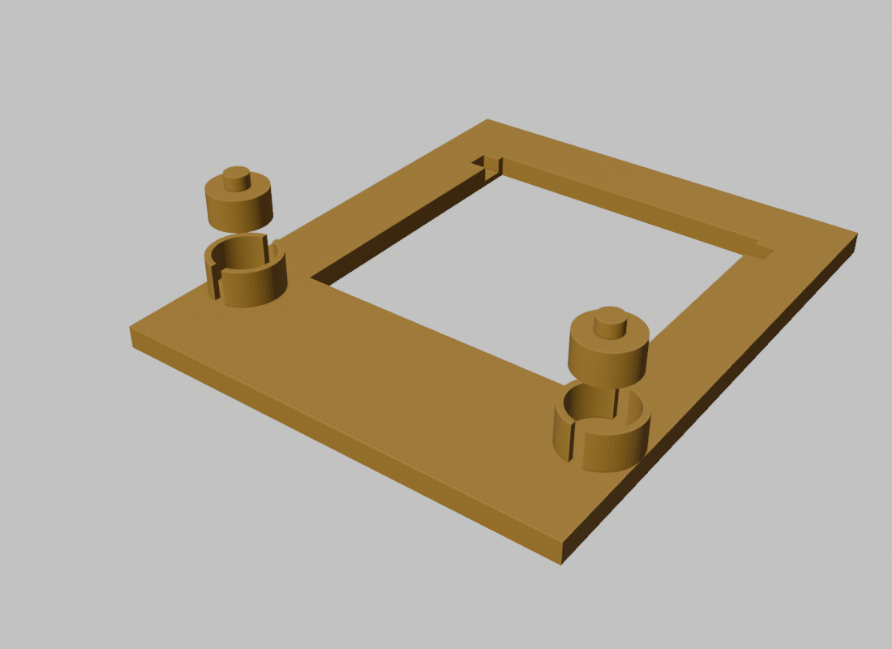
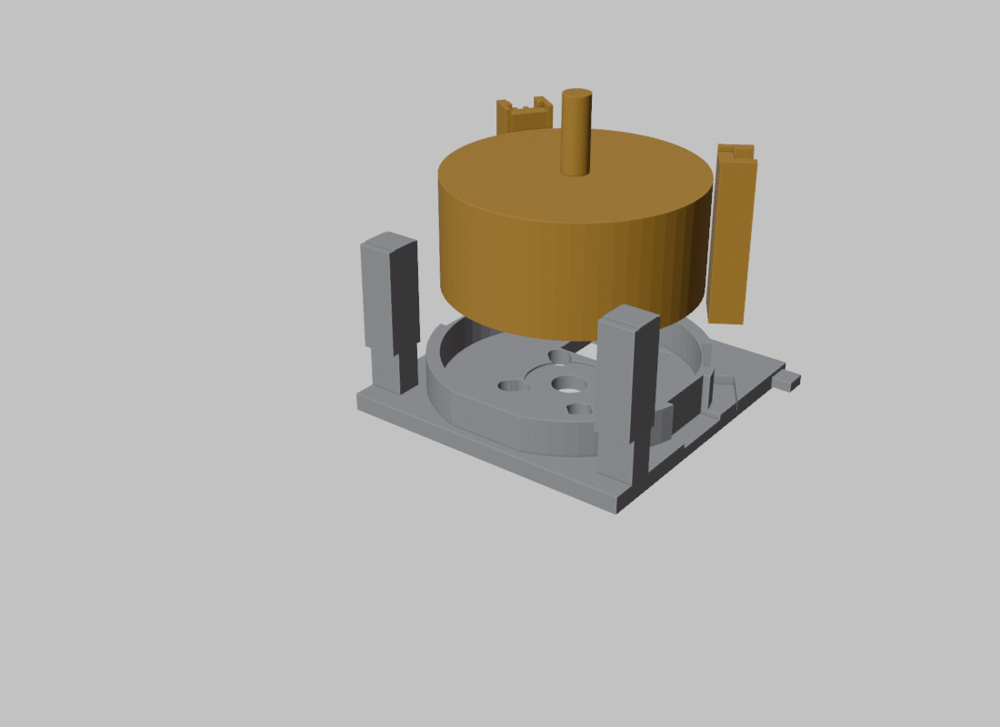
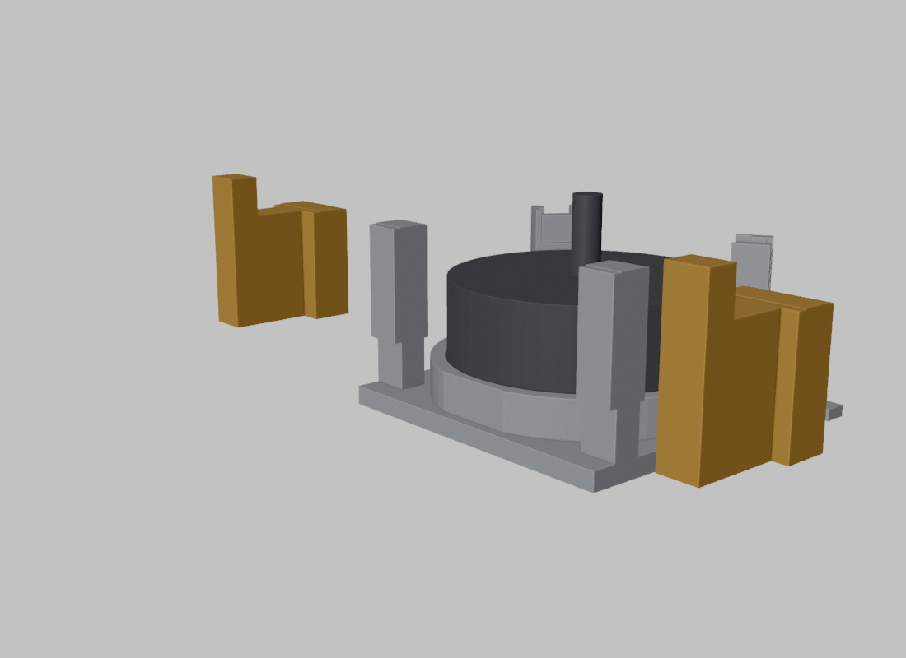
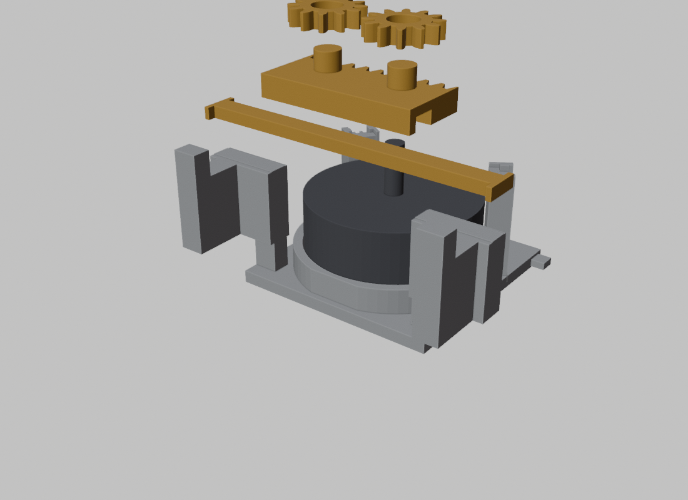
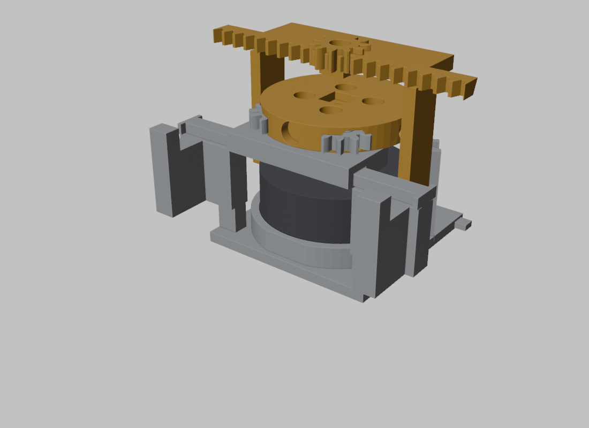
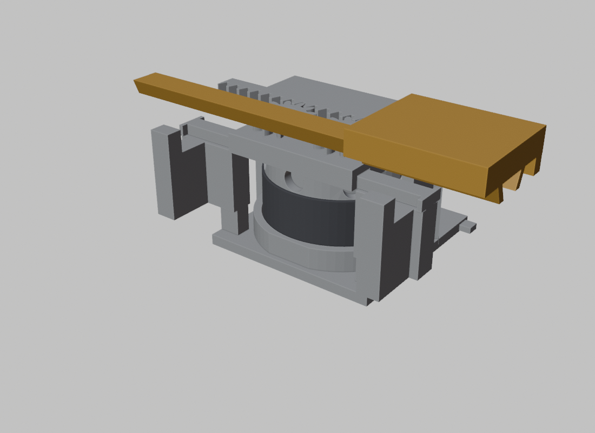
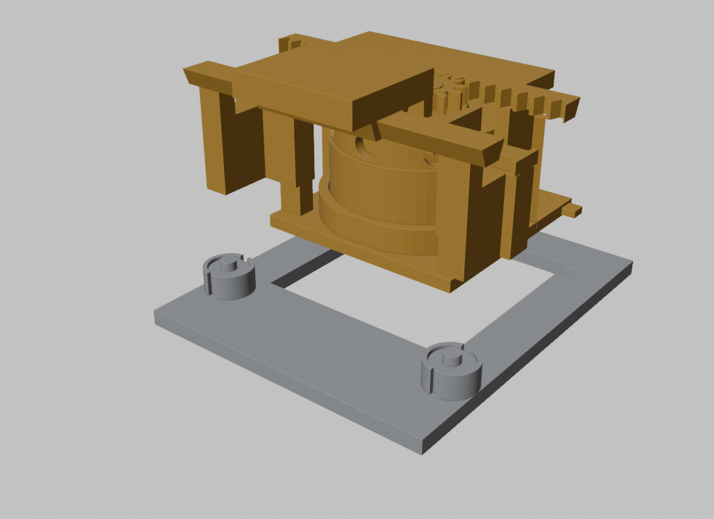
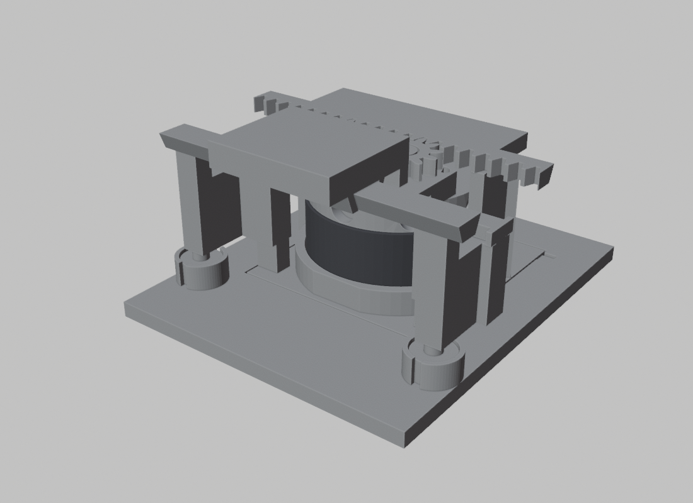

# Сборка модуля З (окантовка 8)

Серое на картинках — уже собрано, оранжевое — ставим на этом шаге (раздвинуто, двигать в сторону серого).

1. **Окантовка и кнопки.** Две кнопки Ø6.4 кладутся в вазы окантовки, выводами в щели по бокам.
   
2. **Мотор и стойки 49E.** Мотор в кольцо пола (или макет `12`). Стойки датчиков низом в прорези кольца и пола, датчик сверху в гнездо стойки, лицом к мотору.
   
3. **Ножки балки (`03a` правая, `03b` левая).** Каждая ножка приклеивается **снаружи к стойке бруска** — серая колонна у края пола справа и слева. Плоская сторона ножки прилегает к наружной грани стойки, низ ножки — на одном уровне с низом блока (оба висят над окантовкой, над кнопками). Высокая часть ножки — спереди, на неё потом ляжет балка.
   
4. **Брусок, ползун, плавающие шестерни.** Брусок `05` на верх стоек (клей), упоры на его концах — снаружи. Ползун `06` пазом снизу на брусок. Две шестерни `07` на оси ползуна.
   
5. **Рейка-«столик» и ротор.** Рейка `04` — низом стенок в паз пола, зубьями к шестерням. Платформа ротора `09` (8 магнитов боком, N/S через один) на торец мотора винтами М2, шестерня мотора `08` квадратом в гнездо платформы, клей.
   
6. **Балка и тележка.** Балка `03c` — на верх ножек, клей. Тележка `11` надевается на балку с торца, крючками за хвост балки, рейкой к шестерням.
   
7. **Модуль в окантовку.** Весь модуль опускается в окантовку: язычки по бокам пола — в ямки окантовки (это ось качания), низы ножек балки и блоков — над кнопками.
   
8. **Готово.** Нажал на тележку — модуль наклоняется на язычках, ножки давят на кнопки.
   
