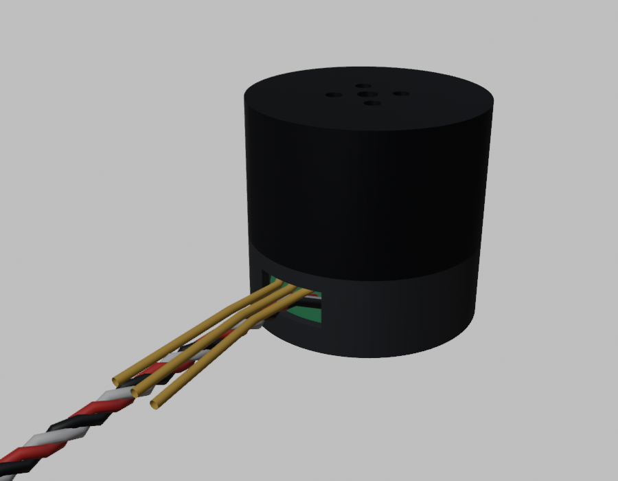

  

:file[моторы 4-ре штуки.blend](/homepage/iniciativa.-razrabotka/jepik-ruka-gitara/t-tros-reabilitacija/.files/motory4-reshtuki.blend)

Концепт владельца (26.11): **четыре зубчатых ремня из TPU поперёк грифа**, по одному на палец. Под ремнями в одной плоскости стоят
четыре гимбал-мотора GB1806 в шахматном порядке, на роторе каждого — ведущий ролик. На концах ремней — ролики с юбкой, тележка пристёгнута
к верхней ветви ремня и ездит от 6-й струны до 1-й. Сверху и по бокам — корпус; прорези в крышке ведут тележки. Вибрацию даёт сам
гимбал-мотор через ремень и корпус — вибромоторы на тележках не нужны.

**Сейчас — версия 13** (remni4_v13.blend): как v11, но **гриф 53 мм** и ремень под сопло 0.4 — спинка 0.9, 39 зубьев шагом 2.66, ролики на 6 зубьев (21.20, 21.21). Версия 11 (remni4_v11.blend): как v10, плюс палуба 1 мм под роликами (21.17). струны 8.4, тележка 7.5, бока сплошные, ремень один — зубья на всю высоту,
концевые ролики Ø5 — свободные шестерёнки, ведущий Ø5 стоит в центре петли и цепляет обе ветви, высота вместе с плитой грифа 29.4 мм.
Если на пробе ремень будет проскакивать — запасной вариант с обхватом «Ω» уже готов (v8, 21.15). Модель: [3-0/remni](https://github.com/Korvova/gitar/tree/main/3-0/remni)
(в сцене пробел — тележки ездят, сверху для ориентира нарисованы струны; крышку можно спрятать, чтобы увидеть ремни).
Модель самого мотора с отверстиями и проводами: [3-0/gb1806](https://github.com/Korvova/gitar/tree/main/3-0/gb1806).

## Этап 1. Геометрия и компоновка (26.11)

| Номер | Требование | Описание | Урок | Статус |
|---|---|---|---|---|
| 21.1 | Ширина грифа ~~52~~ **53 мм** (v13) — ничего не выходит за габарит | Ширина у 1-го лада 52 мм. Бока корпуса 0.8 мм сплошные, внутри габарита; петля ремня с юбкой ролика стоит внутри стенки | Сначала в боку на уровне ремней были щёлочки под петли (иначе не хватало хода) — владелец попросил без щелей: решили сдвигом струн (21.2) | ✅ В модели (v8) |
| 21.21 | Гриф 53 мм вместо 52 (владелец, v13, 26.11) | У ремня под сопло 0.4 спинка 0.9 (было 0.6): петля вокруг концевого ролика на ±22 доходила до 25.4, а стенка при 52 начиналась с 25.2 — ремень тёрся бы о стенку. Варианты: ролики внутрь на ±21.7 (ремень короче на 1.2 — перепечатать, ушко тележки 1.4) или гриф шире. Выбрали **53**: зазор петли до стенки 0.3, ролики на ±22, ремни и ролики из пробы (столы 125/126) встают как есть, струны и ход тележек те же. Блок **53 × 58**, высота с плитой грифа 29.4  | Гриф гитары к корпусу расширяется: у классики у порожка 52, к 12-му ладу ~62 — лишний миллиметр рука не заметит | ✅ В модели (v13) |
| 21.2 | Струны: шаг 8.4, размах 42, до края 5 мм | Было по ТЗ 8.8 / 44 / 4. Владелец (26.11): тренажёр — без фанатизма, струны чуть ближе к центру; 42 мм — как у порожка классической гитары | Это и дало место под концевые ролики Ø5 и сплошную стенку | ✅ В модели (v8) |
| 21.3 | Толщина: эталон 25 мм, рабочий максимум 30 | Вместе с плитой грифа 2 мм — **28.5 мм**: плита 2 + дно блока 1 + мотор со стаканом 20.5 + зазор и юбки 0.6 + ремень 2 + крышка 1 + площадка 1.4 | Почти всю высоту даёт мотор со стаканом (20.5); механизм над ним — ~5 мм. Без правок v2 (тоньше ремень, крышка, дно; ролики с юбкой вместо палубы) было бы 30.2 С палубой 1 мм (21.17) — **29.4 мм** | ⚠️ 29.4 — в пределах 30, выше эталона |
| 21.4 | Четыре тележки | Площадка ~~7.5~~ **8.5 × 10 мм** (v13, как в ТЗ), четыре ряда с шагом 11.25 мм (с «Ω» — 12) | При грифе 52 тележка 8.5 выходила за край — уменьшали до 7.5 (v8). С грифом 53 (21.21) крайняя тележка доходит до ±25.25 при крае ±26.5. Владелец: тележке чуть выйти за край не страшно — главное, чтобы ролики не выходили | ✅ В модели (v13) |
| 21.5 | Ход тележки 42 мм | Центр тележки от 6-й струны до 1-й (±21 от оси грифа) | | ✅ В модели (v8) |
| 21.6 | Концевые ролики Ø5 | Оси на ±22.0 мм, ролик с юбкой; зажим тележки в крайнем положении не доходит 0.4 мм до точки, где ремень загибается | Ø3 пугал (не напечатать) — с Ø4 не хватало 0.1 мм при стенке 0.8, с Ø5 — после сдвига струн (21.2) | ✅ В модели (v8) |
| 21.7 | Моторы в шахматку в одной плоскости под ремнями | GB1806 стоя: стакан с датчиком вниз (провода сразу у дна), ротор вверху с ведущим роликом. Соседние ряды — моторы на разных краях (x ±13), ось мотора — на оси своего ряда | Блок по крайним моторам **52 × 58 мм** (с «Ω» — 52 × 60). Проверка по всей анимации: ряды, тележки и моторы не задевают друг друга | ✅ В модели (v8) |
| 21.8 | Корпус сверху и по бокам | Крышка 0.8 мм с прорезями 1.6 мм над каждым ремнём: через прорезь проходит пластинка тележки — сверху площадка пальца, снизу зажим на ремень. Прорезь сама ведёт тележку, отдельная балка с полозом не нужна | Оси всех роликов висят из крышки — снизу под ними крутятся роторы моторов | ✅ В модели (v8) |
| 21.13 | ~~Палуба под ремнями (идея владельца)~~ | ~~Тонкая пластина под ремнями с осями роликов~~ | ~~+1.5 мм высоты~~ — сначала заменили роликами с юбкой (21.14), потом вернули тоньше — 21.17 | ❌ Исключено 26.11 → см. 21.17 |
| 21.14 | Ролики «цилиндр с юбкой» (идея владельца) | Снизу у каждого ролика юбка — на ней лежит ремень; ось висит из крышки. Палуба не нужна. Концевые ролики Ø5 — свободные шестерёнки (~8 зубьев), ремень сам их проворачивает | Шестерёнку Ø5 печатать соплом 0.2–0.25 или надеть печатный зубчатый стаканчик на подшипник MR52 (2 × 5 × 2.5) | ✅ В модели (v10) |
| 21.19 | Запасной вариант: моторы 2204 вместо GB1806 (v12, 26.11) | Если гриф 29.4 мм окажется неудобным. 2204 — Ø27.8 × 13 мм, без стакана; в шахматку при шаге 11.25 не встают, поэтому **шаг лент 17.5**, оси моторов ±11.1 (мотор внутри стенки 0.8). Блок **52 × 82.5** (было 52 × 58), высота вместе с плитой грифа **21.9 мм** (было 29.4). Самый малый зазор между моторами соседних лент — 0.47 мм. Своего датчика у 2204 нет — идея владельца: магнит Ø3 в низ свободного концевого ролика и AS5600 своей маленькой платой (~7 × 10) под палубой в пустом углу: датчик меряет сам ремень, высота не растёт. Кнопка клика — «клавиша пианино» (например, полоска крышки над лентой на гибком язычке давит на SMD-кнопку). Модель: [remni4_v12_2204.blend](https://github.com/Korvova/gitar/tree/main/3-0/remni)  | Длина блока вдоль грифа не проблема (владелец). Основной пока — v11 на GB1806: многое готово, датчик в заводском стакане | 💡 Запасной, в модели |

## Этап 2. Привод и режимы

| Номер | Требование | Описание | Урок | Статус |
|---|---|---|---|---|
| 21.9 | Четыре зубчатых ремня TPU 95A–98A | Ремень 2.0 мм по высоте, спинка 0.6, зубья 0.4 мм внутрь петли **на всю высоту** (шаг 2 мм) | Было (v5–v8): ремень из двух полос — лысая для роликов и зубчатая для ведущего. Владелец: проще один ремень с зубьями на всю высоту и зубчатые концевые ролики — зуб вдвое крепче, проточки не нужны. Тонкая спинка легче огибает ролики и дала запас хода (21.6) | ⬜ Проверить вживую |
| 21.15 | Ведущий ролик Ø5 с обхватом «Ω» (идея владельца) | Два прижимных ролика Ø2.4 **снаружи** петли по бокам от ведущего (±5 мм) идут по гладкой спинке; ремень проходит поверх них и ныряет под ведущий — обхват ~111°, в зацеплении ~2.5 зуба. Верхняя ветвь с тележкой идёт ровно | Без прижимных ремень сам обнимет ведущий только на ~30° (~1 зуб — может проскакивать). Сначала прижимные были внутри петли (обхват 83°) — снаружи лучше. Из-за глубокого провала шаг лент 12 | 💤 Запасной вариант (v8) — если на пробе v10 ремень проскакивает |
| 21.17 | Палуба 1 мм под роликами (владелец, v11) | Одна пластина 1 мм над моторами на весь блок (зазор над роторами 0.2). Оси концевых роликов стоят в палубе, ведущие проходят сквозь неё ступицей Ø3.8 на ротор (отверстия Ø4.6). Юбки роликов 0.3 мм лежат на палубе. Ремни, ролики и тележки собираются на палубе отдельным узлом, потом палуба кладётся на моторы | Высота +0.9 мм: 28.5 → 29.4 (до максимума 30 остаётся 0.6). Без юбок ремень лёг бы прямо на палубу (−0.3 мм), но тёрся бы краем — для режима ученика лишнее трение | ✅ В модели (v11) |
| 21.16 | Ведущий ролик Ø5 в центре петли — первая проба (владелец) | Ведущий стоит между ветвями на оси ряда и цепляет зубьями обе ветви (верхнюю и нижнюю), прижимных роликов нет | Обхват почти точечный — на каждой ветви ~1 зуб; если будет проскальзывать — переходим на «Ω» (21.15) | ✅ В модели (v10), ⬜ проверить вживую |
| 21.18 | Ремни TPU и ролики к ним на печать — подбор лучшей пары (26.11) | Ремень — замкнутая петля **52 зуба внутрь**, длина на 0.5 % короче петли на роликах Ø5 с центрами ±22 (натягивается сам); печать кольцом плашмя Ø34, **TPU**. Ширина 2 / 3 / 4 / 5 мм × четыре профиля зуба: **A «обычный»** (как GT2 под сопло 0.4: зуб 0.75, основание 1.2, спинка 0.65), **B «глубокий»** (зуб 1.0, основание 1.35, спинка 0.9), **C «трапеция»** (владелец: прямоугольный зуб цепляет лучше — зуб 0.8, основание 1.25, вершина 0.85, спинка 0.8), **D «прямой»** (владелец: стенки зуба прямые 90° — зуб 0.8 × 0.9, спинка 0.8; паз ролика у входа шире на 0.22 с каждой стороны, иначе на Ø5 прямой зуб упирается углом). К каждому ремню — **свой ролик** Ø5: 8 пазов под его зуб (зазор 0.1), юбки 0.6 с обеих сторон, ось Ø1.8; печать PLA/PETG, лучше сопло 0.2–0.25. Печать: ремни — стол `123_remen_TPU.3mf` (16 шт., TPU, дома), ролики — `124_roliki_k_remnyam.3mf` (по 2 на ремень, 32 шт., на работе). Файлы: [3-0/remni/remen_tpu](https://github.com/Korvova/gitar/tree/main/3-0/remni/remen_tpu), генератор [remen_tpu.py](https://github.com/Korvova/gitar/blob/main/3-0/remni/remen_tpu.py); имя ремня и ролика совпадают (`remen_B_glubokij_3mm` ↔ `rolik_B_glubokij_3mm`). Проба: ремень на два ролика с центрами 44 мм, крутить ролик, тянуть тележку — проскакивает ли, как легко ходит.  | Совсем прямоугольный зуб на ролике Ø5 с 8 зубьями не встаёт: упирается на входе в паз, пазы у дна сливаются — поэтому трапеция со стенками ~14° (C), а для прямого зуба (D) паз ролика расширен у входа. Тонкое место — ролик B: от оси до дна паза 0.54 мм (у A 0.79, у C и D 0.74) | 🔄 Печать и проба |
| 21.20 | Ремни и ролики под стандартное сопло Bambu 0.4 (26.11) | Сопло 0.4 кладёт линию ~0.45, самая тонкая стенка — 2 линии (~0.9). У ролика Ø5 на 8 зубьев (21.18) зуб у дна выходил ~0.27 — меньше линии, пазы сливаются; поэтому комплект «под 0.4»: **ролик 6 зубьев** (тот же Ø5.08), паз прямоугольный 1.1 × 0.8 без скосов (владелец: TPU-зуб сам сядет), зуб ролика у дна 0.72, стенка от оси Ø1.8 — 0.84. **Ремень 39 зубьев шагом 2.66**, зуб прямой 0.9 × 0.7, спинка 0.9, натяг 0.5 %, кольцо Ø34.6, ширина 2 / 3 / 4 / 5. Столы: **125_remen_TPU_04** — 8 ремней: верхний ряд с ушками-пилами, нижний без (на случай, если ушки не пойдут), ширина 2→5 слева направо (TPU, дома); **126_roliki_04** — 8 роликов, по 2 на ремень, ряд = ширина 2→5 сверху вниз (PLA/PETG, сопло 0.4). Файлы: [3-0/remni/remen_04](https://github.com/Korvova/gitar/tree/main/3-0/remni/remen_04), скрипт remen_04.py  **Ушки-«пилы»** (владелец): на спинке каждого ремня два ушка по 3 мм с промежутком 1.7 под зуб тележки; грань к зубу вертикальная (вынос 1.5), наружу скат до спинки, во всю ширину ремня. На краю хода наружное ушко заходит на ролик и гнётся с ремнём, толкающее остаётся на прямом; до стенки при грифе 53 — 0.59 ([анимация pila_demo.blend](https://github.com/Korvova/gitar/tree/main/3-0/remni/ushko_demo)). В стол 126 добавлены 4 **пробные тележки** (площадка 8.5 × 7, зуб 1.5 × 2.6) — вставить зуб между ушками и тянуть  | Владелец: зубцы и шестерни — идеально под стандартное сопло, мельчить нет смысла. Профили A–D (21.18) рассчитаны на сопло 0.2–0.25 — сравнить, если оно будет | 🔄 На печать |
| 21.22 | Стенд одной ленты — проба хода тележки и зацепа (27.11) | Как в блоке v13: концевые ролики на ±22, ведущий на роторе GB1806 в центре петли (x = +13). Основа 2.5 мм — мотор со стаканом крепится длинными М2 (на 3 мм длиннее штатных); палуба 2 мм на 4 ножках, оси концевых роликов — кусочки филамента 1.75 на натяг (отверстия Ø1.65); рельс и тележка стенда, зуб тележки снаружи юбок роликов — ход ±25. Основа и палуба общие, ведущий ролик, рельс и тележка — под ремни 2/3/4/5 мм; концевые ролики — стол 126, ремни — стол 125. Ведущий ролик сидит на роторе 4 штырями в резьбовые отверстия М2 (на Ø6) + капля клея. Оси концевых роликов — печатные со шляпкой Ø4.5 (низ Ø1.75 на натяг в палубу, по ролику Ø1.6, зазор под шляпкой 0.2) или кусочки филамента. Печать PLA/PETG, сопло 0.4: **129_stend_3mm** — готовый комплект под ремень 3 мм (основа, палуба, ведущий ролик, рельс, тележка, 2 концевых ролика, 4 оси — 11 деталей, «напечатал и собрал»); 127_stend_remen — все ширины, 128_ved_rolik_shtyri — подбор штырей. **130_shesterni_i_osi** (28.11, печать дома) — шестерни на все ширины ремня: ряд = ширина 2→5 сверху вниз, в ряду слева 2 концевых ролика под болт М2, в середине ведущий ролик (штыри Ø1.6), справа 2 концевых ролика под очковый винт М1.4 — 20 деталей. **28.11 (владелец): оси концевых роликов — болты М2.** Отверстие роликов Ø2.2 (было 1.8) — ролик свободно крутится на болте; чтобы стенка не стала тонкой, дно паза ближе к зубу (зазор 0.02 вместо 0.1), стенка от отверстия до дна паза 0.72. В палубе отверстия Ø1.7 (было 1.65) — болт вкручивается как саморез (в уже напечатанную 1.65 — с усилием). Длина болта по ширине ремня: 2 → М2×5, 3 → М2×6, 4 → М2×7, 5 → М2×8 (под правым роликом ротор мотора — длиннее нельзя); не дотягивать, чтобы ролик крутился. Печатные оси со шляпкой больше не нужны. **Вторая версия — очковые винты М1.4** (из набора, головка Ø2.5): ролики rolik04_m14 с отверстием Ø1.8 (стенка толще, подходят и ролики стола 126 первой печати), палуба stend_paluba_m14 с отверстиями Ø1.1 под саморез (в палубу с 1.65 — на каплю суперклея); ремень 3 → М1.4×6, 5 → М1.4×8, 2 и 4 — ×6 / ×8 с шайбой под головкой. Готовый комплект под ремень 3 мм на М1.4 — **131_stend_3mm_m14** (под М2 — 129). Код: [3-0/remni/stend](https://github.com/Korvova/gitar/tree/main/3-0/remni/stend)  | Штыри Ø1.9 в отверстия М2 ротора не лезли. Напечатали подбор 1.4 / 1.5 / 1.6 / 1.7 / 1.8 (метка — 1…5 насечек на проставке): **идеально сел Ø1.6** — он теперь по умолчанию. Пробные тележки стола 126 на стенде цепляют юбку ведущего — брать тележки стенда | ✅ Штыри подобраны, ⬜ ход и зацеп — проверить |
| 21.23 | «Гусеница»: ленты стоят вертикально, моторы вынесены за зону пальцев (владелец, 28.11) | Каждая лента — вертикальная петля поперёк грифа (шаг 11.25): на концах ролики Ø10 (12 зубьев) на x = ±20.5, ремень обнимает ведущий на ~180° (6 зубьев в зацеплении — против ~1 зуба у плоской петли). Моторы GB1806 лёжа, по два в блоке с каждого конца зоны пальцев (А — ленты 1 и 2, Б — 3 и 4): вал мотора проходит обе ленты своего блока — на своей ведущий ролик, на соседней свободный ролик крутится на неподвижной трубке, вал внутри неё. Сверху над лентой **крышка-клавиша** с прорезью: закрывает ремень, ведёт тележку (стойка в прорези, лапки под крышкой) и жмёт кнопку — качается на гибком язычке вдоль ДЛИННОГО края (стенка между лентами), кнопка под серединой другого края, поэтому место тележки на нажатие не влияет. Ушки-пилы смотрят вверх, зуб тележки — между ними. Зона пальцев **24.3 мм** с плитой грифа (v13 — 29.4); моторы в блоках выходят за гриф на 5 мм с каждой стороны (за зоной пальцев это не важно). Вибрация: гимбал через ремень; в запасе — связь от неподвижного стакана мотора к стенке (v6; перед мотором крутится корпус!) или вибромотор-таблетка Ø8 × 2.5 на крышке. Модели: [remni_gusenica_v5.blend / v6](https://github.com/Korvova/gitar/tree/main/3-0/remni)  | Угловые ролики Ø5 рядом с Ø10 пересекались (заметил владелец) — убрали, остались два Ø10. Первая петля ведущего Ø5 в центре давала ~1 зуб и проскакивала на стенде 21.22 | 💡 Концепт, ⬜ проверить стендом 21.24 |
| 21.24 | Стенд «гусеницы» на один мотор — проверить, как всё пойдёт (28.11) | Одна лента: мотор GB1806 лёжа на кронштейне (6 отверстий М2 на Ø18 под стакан, центр Ø6 под провода; крепёж как на 21.22 — М2 на 3 мм длиннее штатных), ведущий ролик Ø10 на роторе (проставка 6.7 + 4 штыря Ø1.6 в М2 ротора), свободный Ø10 на болте М2 × 10 в столбике (не дотягивать). Ремень 43 зуба, ширина 3, ушки-пилы (зазор к зубу 0.2, конец ската 0.5), кольцо Ø38. Крышка-клавиша со стенкой и язычком — одна деталь (печать крышкой на стол), стенка вставляется в паз дна (на клей); круглая кнопка Ø6 (корпус Ø6.4 × 3.5, шток 1.5) в стакане-«вазе» под серединой свободного края — как в модулях 19.x; шток касается низа крышки, стакан не задевает ремень (зазор 0.35). Тележка вставляется в расширение прорези на конце (за ходом ±21) и сдвигается. Проверка скриптом: ход ±21 — ничего не задевает, тележку не поднять больше чем на 0.3. Печать: **132_stend_gusenica** (PLA/PETG: дно, клавиша, 2 ролика, 2 тележки), **133_gus_remen_TPU** (2 ремня: с ушками и без). Код: [3-0/remni/stend_gus](https://github.com/Korvova/gitar/tree/main/3-0/remni/stend_gus)  | | 🔄 На печать |
| 21.10 | Мотор GB1806 с датчиком AS5600 | Три провода из коробки — это датчик (красный +5V, белый PWM, чёрный GND) в стакане; фазы мотора припаять на три площадки под стаканом. Модель мотора — [3-0/gb1806](https://github.com/Korvova/gitar/tree/main/3-0/gb1806) | Датчик однооборотный: обороты ролика досчитывает программа, ноль — по упору при включении | ⬜ Не начато |
| 21.11 | Режим ученика | Тележки свободно двигаются пальцами, положение отслеживается по датчику мотора | Гимбал легко проворачивается рукой — для этого режима он и выбран; ролики на подшипниках — меньше трения | ⬜ Не начато |
| 21.12 | Режим учителя | Моторы сами ставят тележки на нужные струны и дают вибрацию в нужном месте самим гимбалом — через ремень и корпус | | ⬜ Не начато |

