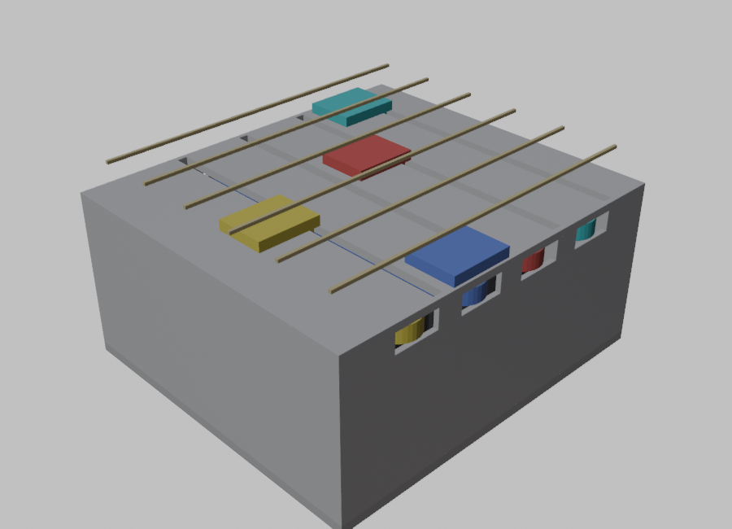
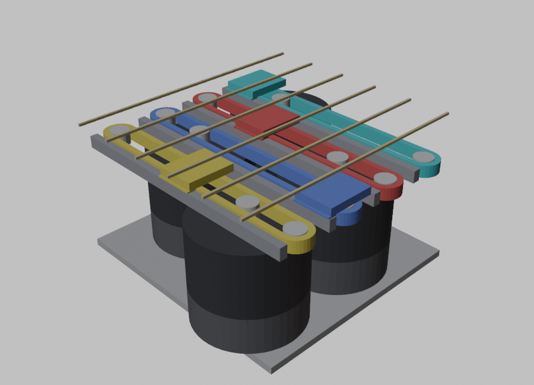

  

:file[моторы 4-ре штуки.blend](/homepage/iniciativa.-razrabotka/jepik-ruka-gitara/t-tros-reabilitacija/.files/motory4-reshtuki.blend)

Концепт владельца (26.11): **четыре зубчатых ремня из TPU поперёк грифа**, по одному на палец. Под ремнями в одной плоскости стоят
четыре гимбал-мотора GB1806 в шахматном порядке, на роторе каждого — ведущий ролик. На концах ремней — ролики Ø4, тележка пристёгнута
к верхней ветви ремня и ездит от 6-й струны до 1-й. Сверху и по бокам — корпус; прорези в крышке ведут тележки. Вибрацию даёт сам
гимбал-мотор через ремень и корпус — вибромоторы на тележках не нужны.

Модель по этому ТЗ с настоящими размерами GB1806: [3-0/remni](https://github.com/Korvova/gitar/tree/main/3-0/remni)
(`remni4_korpus.blend` — с корпусом, `remni4.blend` — без; в сцене пробел — тележки ездят, сверху для ориентира нарисованы струны).
Модель самого мотора с отверстиями и проводами: [3-0/gb1806](https://github.com/Korvova/gitar/tree/main/3-0/gb1806).

## Этап 1. Геометрия и компоновка (26.11)

| Номер | Требование | Описание | Урок | Статус |
|---|---|---|---|---|
| 21.1 | Ширина грифа 52 мм — ничего не выходит за габарит | Ширина у 1-го лада 52 мм. Бока корпуса 0.8 мм — внутри габарита; петли ремней на концевых роликах стоят вровень с краем | Если петлю ремня накрыть боковой стенкой, тележке не хватает ~1 мм хода (ремень 1.2 мм огибает ролик Ø4). Поэтому в боку на уровне ремней — щёлочки высотой 3 мм, между ними стойки | ✅ В модели |
| 21.2 | Струны: шаг 8.8, размах 44, отступ 4 | Центры струн −22 … +22 от оси грифа, по 4 мм до краёв | | ✅ В модели |
| 21.3 | Толщина: эталон 25 мм, рабочий максимум 30 | С настоящим GB1806 (Ø22 × 20.5 со стаканом датчика): без корпуса верх площадок 26.8 мм, с крышкой — 28.2 мм | Почти всю высоту даёт мотор со стаканом (20.5). В исходной модели мотор был Ø20 × 13 | ⚠️ 28.2 — в пределах 30, выше эталона |
| 21.4 | Четыре тележки 8.0–8.5 мм | Площадка 8.0 × 10 мм, четыре ряда с шагом 11.25 мм | При 8.5 и ходе ±22 тележка в крайнем положении выходит за край на 0.25 мм — взяли 8.0, ровно в отступ 4 мм | ✅ В модели |
| 21.5 | Ход 44 мм | Центр тележки от 6-й струны (4 мм от края) до 1-й (48 мм) | | ✅ В модели |
| 21.6 | Концевые ролики Ø4 | Оси роликов на ±22.7 мм: ролик с ремнём целиком внутри 52 | Зажим тележки на ремне — 1.2 мм шириной, иначе в крайнем положении упирается в ролик | ✅ В модели |
| 21.7 | Моторы в шахматку в одной плоскости под ремнями | GB1806 стоя: стакан с датчиком вниз (провода сразу у дна), ротор вверху с ведущим роликом. Соседние ряды — моторы на разных краях (x ±13), через ряд — на одном | Моторы Ø22 через ряд стоят на 22.5 мм — поэтому шаг рядов не меньше 11.25. Блок по крайним моторам 52 × 57 мм. Проверка по всей анимации: ряды и тележки не задевают друг друга | ✅ В модели |
| 21.8 | Корпус сверху и по бокам | Крышка 1.2 мм с прорезями 1.6 мм над каждым ремнём: через прорезь проходит пластинка тележки — сверху площадка пальца, снизу зажим на ремень. Прорезь сама ведёт тележку, отдельная балка с полозом не нужна | Оси концевых роликов держит крышка: внизу под ними крутятся роторы моторов. Прорези кончаются за 1 мм до края — крышка остаётся одной деталью | ✅ В модели |
| 21.13 | Палуба под ремнями (идея владельца) | Тонкая пластина между моторами и ремнями: в ней стоят оси концевых роликов, над ротором — отверстие под ведущий ролик. Ремни с роликами собираются на палубе отдельным узлом, потом палуба ставится на моторы, крышка сверху только закрывает и ведёт тележки | Оси держатся с двух концов (палуба + крышка) — жёстче и проще сборка. Цена — около +1.5 мм высоты: ~29.7 мм, ещё в пределах 30 | ⬜ Не начато |

## Этап 2. Привод и режимы

| Номер | Требование | Описание | Урок | Статус |
|---|---|---|---|---|
| 21.9 | Четыре зубчатых ремня TPU 95A–98A | Ремень 2.5 мм по высоте, 1.2 мм толщиной с зубом; ведущий ролик Ø4 на роторе стоит между ветвями ремня | Риски, проверить вживую: на ролике Ø4 ремень касается почти в точке — зубья могут проскакивать (тогда два маленьких прижимных ролика по бокам ведущего); TPU тянется — датчик видит угол мотора, а не тележку, поэтому лучше 98A | ⬜ Не начато |
| 21.10 | Мотор GB1806 с датчиком AS5600 | Три провода из коробки — это датчик (красный +5V, белый PWM, чёрный GND) в стакане; фазы мотора припаять на три площадки под стаканом. Модель мотора — [3-0/gb1806](https://github.com/Korvova/gitar/tree/main/3-0/gb1806) | Датчик однооборотный: если ход тележки больше оборота ролика, обороты досчитывает программа, ноль — по упору при включении | ⬜ Не начато |
| 21.11 | Режим ученика | Тележки свободно двигаются пальцами, положение отслеживается по датчику мотора | Гимбал легко проворачивается рукой — для этого режима он и выбран | ⬜ Не начато |
| 21.12 | Режим учителя | Моторы сами ставят тележки на нужные струны и дают вибрацию в нужном месте самим гимбалом — через ремень и корпус | | ⬜ Не начато |

