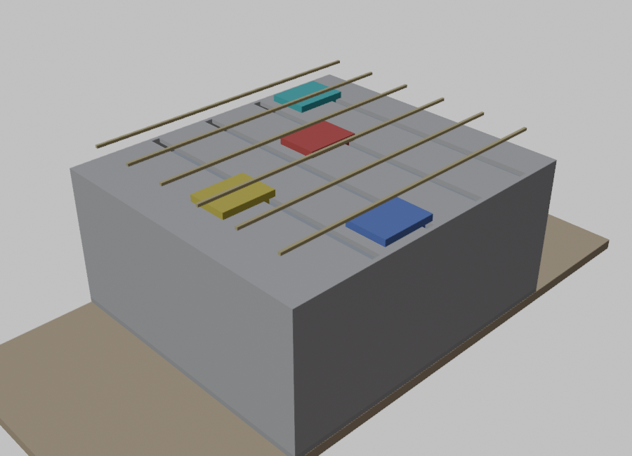
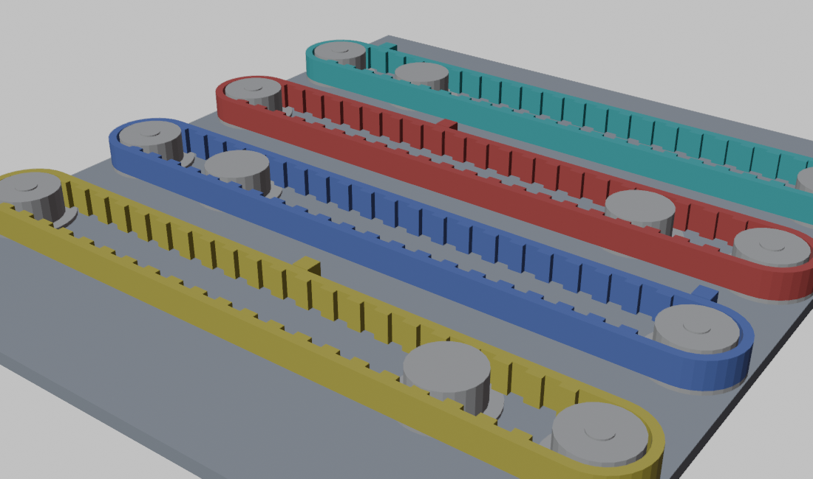

  

:file[моторы 4-ре штуки.blend](/homepage/iniciativa.-razrabotka/jepik-ruka-gitara/t-tros-reabilitacija/.files/motory4-reshtuki.blend)

Концепт владельца (26.11): **четыре зубчатых ремня из TPU поперёк грифа**, по одному на палец. Под ремнями в одной плоскости стоят
четыре гимбал-мотора GB1806 в шахматном порядке, на роторе каждого — ведущий ролик. На концах ремней — ролики с юбкой, тележка пристёгнута
к верхней ветви ремня и ездит от 6-й струны до 1-й. Сверху и по бокам — корпус; прорези в крышке ведут тележки. Вибрацию даёт сам
гимбал-мотор через ремень и корпус — вибромоторы на тележках не нужны.

**Сейчас — версия 11, для первой пробы** (remni4_v11.blend): как v10, плюс палуба 1 мм под роликами (21.17). струны 8.4, тележка 7.5, бока сплошные, ремень один — зубья на всю высоту,
концевые ролики Ø5 — свободные шестерёнки, ведущий Ø5 стоит в центре петли и цепляет обе ветви, высота вместе с плитой грифа 29.4 мм.
Если на пробе ремень будет проскакивать — запасной вариант с обхватом «Ω» уже готов (v8, 21.15). Модель: [3-0/remni](https://github.com/Korvova/gitar/tree/main/3-0/remni)
(в сцене пробел — тележки ездят, сверху для ориентира нарисованы струны; крышку можно спрятать, чтобы увидеть ремни).
Модель самого мотора с отверстиями и проводами: [3-0/gb1806](https://github.com/Korvova/gitar/tree/main/3-0/gb1806).

## Этап 1. Геометрия и компоновка (26.11)

| Номер | Требование | Описание | Урок | Статус |
|---|---|---|---|---|
| 21.1 | Ширина грифа 52 мм — ничего не выходит за габарит | Ширина у 1-го лада 52 мм. Бока корпуса 0.8 мм сплошные, внутри габарита; петля ремня с юбкой ролика стоит внутри стенки | Сначала в боку на уровне ремней были щёлочки под петли (иначе не хватало хода) — владелец попросил без щелей: решили сдвигом струн (21.2) | ✅ В модели (v8) |
| 21.2 | Струны: шаг 8.4, размах 42, до края 5 мм | Было по ТЗ 8.8 / 44 / 4. Владелец (26.11): тренажёр — без фанатизма, струны чуть ближе к центру; 42 мм — как у порожка классической гитары | Это и дало место под концевые ролики Ø5 и сплошную стенку | ✅ В модели (v8) |
| 21.3 | Толщина: эталон 25 мм, рабочий максимум 30 | Вместе с плитой грифа 2 мм — **28.5 мм**: плита 2 + дно блока 1 + мотор со стаканом 20.5 + зазор и юбки 0.6 + ремень 2 + крышка 1 + площадка 1.4 | Почти всю высоту даёт мотор со стаканом (20.5); механизм над ним — ~5 мм. Без правок v2 (тоньше ремень, крышка, дно; ролики с юбкой вместо палубы) было бы 30.2 С палубой 1 мм (21.17) — **29.4 мм** | ⚠️ 29.4 — в пределах 30, выше эталона |
| 21.4 | Четыре тележки | Площадка 7.5 × 10 мм (было 8.0), четыре ряда с шагом 11.25 мм (с «Ω» — 12) | 8.5 выходила за край; 7.5 — с запасом под струны 8.4 | ✅ В модели (v8) |
| 21.5 | Ход тележки 42 мм | Центр тележки от 6-й струны до 1-й (±21 от оси грифа) | | ✅ В модели (v8) |
| 21.6 | Концевые ролики Ø5 | Оси на ±22.0 мм, ролик с юбкой; зажим тележки в крайнем положении не доходит 0.4 мм до точки, где ремень загибается | Ø3 пугал (не напечатать) — с Ø4 не хватало 0.1 мм при стенке 0.8, с Ø5 — после сдвига струн (21.2) | ✅ В модели (v8) |
| 21.7 | Моторы в шахматку в одной плоскости под ремнями | GB1806 стоя: стакан с датчиком вниз (провода сразу у дна), ротор вверху с ведущим роликом. Соседние ряды — моторы на разных краях (x ±13), ось мотора — на оси своего ряда | Блок по крайним моторам **52 × 58 мм** (с «Ω» — 52 × 60). Проверка по всей анимации: ряды, тележки и моторы не задевают друг друга | ✅ В модели (v8) |
| 21.8 | Корпус сверху и по бокам | Крышка 0.8 мм с прорезями 1.6 мм над каждым ремнём: через прорезь проходит пластинка тележки — сверху площадка пальца, снизу зажим на ремень. Прорезь сама ведёт тележку, отдельная балка с полозом не нужна | Оси всех роликов висят из крышки — снизу под ними крутятся роторы моторов | ✅ В модели (v8) |
| 21.13 | ~~Палуба под ремнями (идея владельца)~~ | ~~Тонкая пластина под ремнями с осями роликов~~ | ~~+1.5 мм высоты~~ — сначала заменили роликами с юбкой (21.14), потом вернули тоньше — 21.17 | ❌ Исключено 26.11 → см. 21.17 |
| 21.14 | Ролики «цилиндр с юбкой» (идея владельца) | Снизу у каждого ролика юбка — на ней лежит ремень; ось висит из крышки. Палуба не нужна. Концевые ролики Ø5 — свободные шестерёнки (~8 зубьев), ремень сам их проворачивает | Шестерёнку Ø5 печатать соплом 0.2–0.25 или надеть печатный зубчатый стаканчик на подшипник MR52 (2 × 5 × 2.5) | ✅ В модели (v10) |

## Этап 2. Привод и режимы

| Номер | Требование | Описание | Урок | Статус |
|---|---|---|---|---|
| 21.9 | Четыре зубчатых ремня TPU 95A–98A | Ремень 2.0 мм по высоте, спинка 0.6, зубья 0.4 мм внутрь петли **на всю высоту** (шаг 2 мм) | Было (v5–v8): ремень из двух полос — лысая для роликов и зубчатая для ведущего. Владелец: проще один ремень с зубьями на всю высоту и зубчатые концевые ролики — зуб вдвое крепче, проточки не нужны. Тонкая спинка легче огибает ролики и дала запас хода (21.6) | ⬜ Проверить вживую |
| 21.15 | Ведущий ролик Ø5 с обхватом «Ω» (идея владельца) | Два прижимных ролика Ø2.4 **снаружи** петли по бокам от ведущего (±5 мм) идут по гладкой спинке; ремень проходит поверх них и ныряет под ведущий — обхват ~111°, в зацеплении ~2.5 зуба. Верхняя ветвь с тележкой идёт ровно | Без прижимных ремень сам обнимет ведущий только на ~30° (~1 зуб — может проскакивать). Сначала прижимные были внутри петли (обхват 83°) — снаружи лучше. Из-за глубокого провала шаг лент 12 | 💤 Запасной вариант (v8) — если на пробе v10 ремень проскакивает |
| 21.17 | Палуба 1 мм под роликами (владелец, v11) | Одна пластина 1 мм над моторами на весь блок (зазор над роторами 0.2). Оси концевых роликов стоят в палубе, ведущие проходят сквозь неё ступицей Ø3.8 на ротор (отверстия Ø4.6). Юбки роликов 0.3 мм лежат на палубе. Ремни, ролики и тележки собираются на палубе отдельным узлом, потом палуба кладётся на моторы | Высота +0.9 мм: 28.5 → 29.4 (до максимума 30 остаётся 0.6). Без юбок ремень лёг бы прямо на палубу (−0.3 мм), но тёрся бы краем — для режима ученика лишнее трение | ✅ В модели (v11) |
| 21.16 | Ведущий ролик Ø5 в центре петли — первая проба (владелец) | Ведущий стоит между ветвями на оси ряда и цепляет зубьями обе ветви (верхнюю и нижнюю), прижимных роликов нет | Обхват почти точечный — на каждой ветви ~1 зуб; если будет проскальзывать — переходим на «Ω» (21.15) | ✅ В модели (v10), ⬜ проверить вживую |
| 21.18 | Ремни TPU и ролики к ним на печать — подбор лучшей пары (26.11) | Ремень — замкнутая петля **52 зуба внутрь**, длина на 0.5 % короче петли на роликах Ø5 с центрами ±22 (натягивается сам); печать кольцом плашмя Ø34, **TPU**. Ширина 2 / 3 / 4 / 5 мм × три профиля зуба: **A «обычный»** (как GT2 под сопло 0.4: зуб 0.75, основание 1.2, спинка 0.65), **B «глубокий»** (зуб 1.0, основание 1.35, спинка 0.9), **C «трапеция»** (владелец: прямоугольный зуб цепляет лучше — зуб 0.8, основание 1.25, вершина 0.85, спинка 0.8). К каждому ремню — **свой ролик** Ø5: 8 пазов под его зуб (зазор 0.1), юбки 0.6 с обеих сторон, ось Ø1.8; печать PLA/PETG, лучше сопло 0.2–0.25. Печать: ремни — стол `123_remen_TPU.3mf` (12 шт., TPU, дома), ролики — `124_roliki_k_remnyam.3mf` (по 2 на ремень, 24 шт., на работе). Файлы: [3-0/remni/remen_tpu](https://github.com/Korvova/gitar/tree/main/3-0/remni/remen_tpu), генератор [remen_tpu.py](https://github.com/Korvova/gitar/blob/main/3-0/remni/remen_tpu.py); имя ремня и ролика совпадают (`remen_B_glubokij_3mm` ↔ `rolik_B_glubokij_3mm`). Проба: ремень на два ролика с центрами 44 мм, крутить ролик, тянуть тележку — проскакивает ли, как легко ходит.  | Совсем прямоугольный зуб на ролике Ø5 с 8 зубьями не встаёт: упирается на входе в паз, пазы у дна сливаются — поэтому трапеция со стенками ~14°. Тонкое место — ролик B: от оси до дна паза 0.54 мм (у A 0.79, у C 0.74) | 🔄 Печать и проба |
| 21.10 | Мотор GB1806 с датчиком AS5600 | Три провода из коробки — это датчик (красный +5V, белый PWM, чёрный GND) в стакане; фазы мотора припаять на три площадки под стаканом. Модель мотора — [3-0/gb1806](https://github.com/Korvova/gitar/tree/main/3-0/gb1806) | Датчик однооборотный: обороты ролика досчитывает программа, ноль — по упору при включении | ⬜ Не начато |
| 21.11 | Режим ученика | Тележки свободно двигаются пальцами, положение отслеживается по датчику мотора | Гимбал легко проворачивается рукой — для этого режима он и выбран; ролики на подшипниках — меньше трения | ⬜ Не начато |
| 21.12 | Режим учителя | Моторы сами ставят тележки на нужные струны и дают вибрацию в нужном месте самим гимбалом — через ремень и корпус | | ⬜ Не начато |

